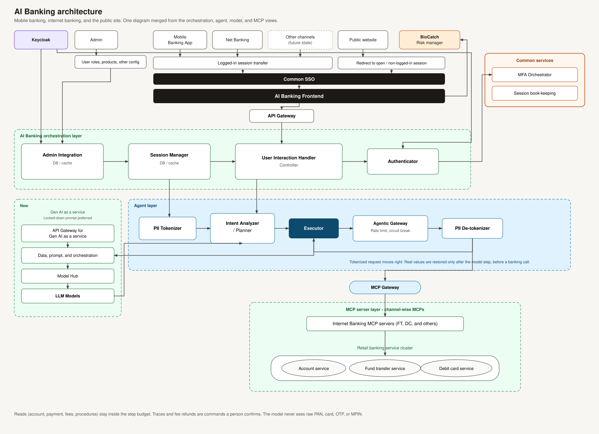

# AI Banking architecture

Single diagram merged from the orchestration view, the Gen AI and agent view, and the channel MCP view.

## How a contact moves

1. **Signed-in channels** (mobile app, net banking, future channels) hand the session over through Common SSO into the AI Banking Frontend. The **public website** enters as an open, non-logged-in session. BioCatch sits on that front door as the risk manager.
2. **Admin** publishes user roles, products, and other config into Admin Integration. **Keycloak** is the identity provider for admin integration and for the Authenticator.
3. The frontend calls the **API Gateway**, which lands in the User Interaction Handler. The Session Manager holds the session. The Authenticator calls **MFA Orchestrator** and **session book-keeping**.
4. The handler passes work into the **agent layer**. PII is tokenized before the Intent Analyzer / Planner and the Executor. The Executor calls **Gen AI as a service** (gateway, prompt orchestration, model hub, LLM models) with a locked-down prompt. The Agentic Gateway applies rate limits and circuit breaking. The **PII de-tokenizer** restores real values only for the outbound banking call.
5. That call goes through the **MCP Gateway** to channel-wise MCP servers. Internet banking MCPs cover fund transfer and debit card, and they call the retail cluster: **Account service**, **Fund transfer service**, **Debit Card service**.

Reads can run inside the agent step budget. A trace or a fee refund is a command a person confirms. Raw PAN, full card number, OTP, and MPIN stay out of the model.
