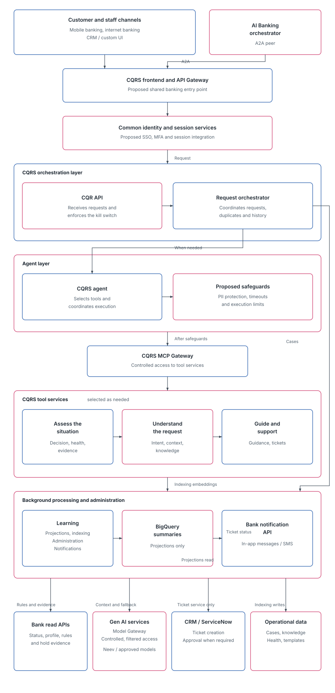

# CQRS architecture

Customer Query Resolution System, drawn in the same style as the [AI Banking architecture](./ai-banking-architecture.md).

## How a request moves

1. **Channels** are mobile banking, internet banking, and the CRM or custom UI. The **AI Banking orchestrator** joins that front door over A2A. Both land on the CQRS frontend and API Gateway, the proposed shared entry point.
2. **Identity and session** is the proposed SSO, MFA, and session integration.
3. The **CQR API** receives the request and enforces the kill switch. The **request orchestrator** coordinates duplicates and history. It calls the agent when a tool or a draft is needed, and it hands cases to background processing.
4. The **CQRS agent** selects tools. Safeguards cover PII protection, timeouts, and execution limits. The **MCP gateway** is the only door to tool services.
5. Tools are chosen per request: assess the situation, understand the request, or guide and support.
6. Those tools read bank APIs, call Gen AI through the model gateway (Neev and the other approved models), open a CRM or ServiceNow ticket when a person must approve, and read operational data. Learning writes projections to BigQuery and sends ticket status through the bank notification API.
